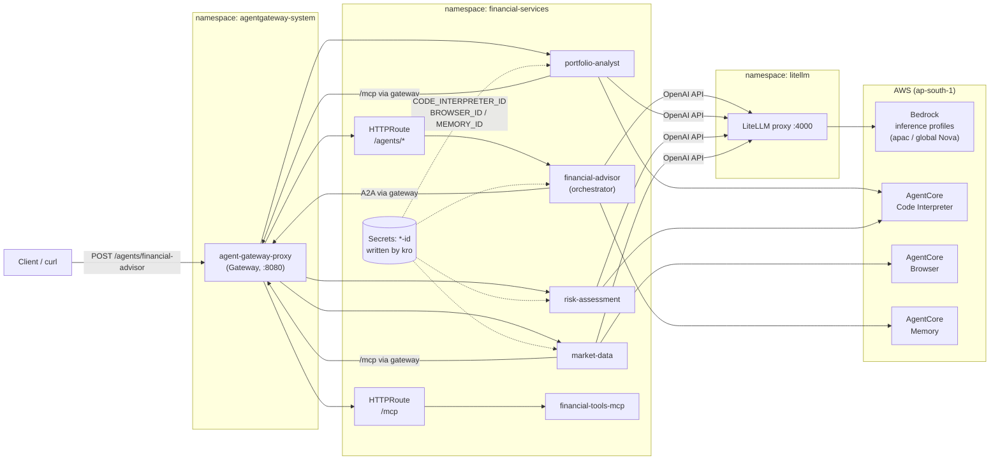
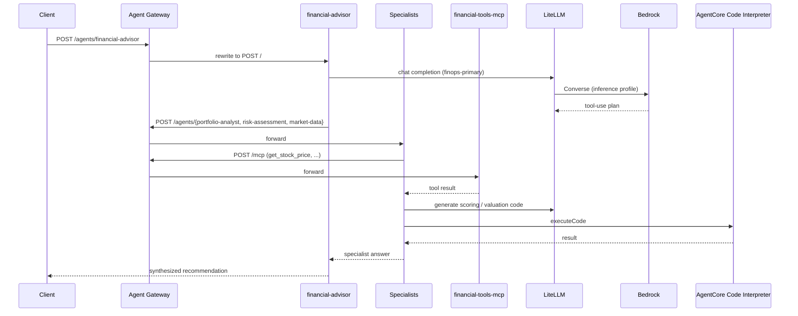

# Financial Services Agents - End-to-End Test Log

Date: 2026-10-11
Cluster: `finops-agents-app-*` (EKS, `ap-south-1`; CI recreates the cluster with a new suffix each run)

## Test request

```bash
kubectl port-forward -n agentgateway-system svc/agent-gateway-proxy 8080:8080 &
TOKEN=$(kubectl create token financial-advisor-sa -n financial-services --duration=1h --audience=agent-gateway)
curl -sS -X POST http://localhost:8080/agents/financial-advisor \
  -H "Authorization: Bearer $TOKEN" \
  -H "Content-Type: application/json" \
  -d '{"task":"I have 100 AAPL and 50 GOOGL. Is my portfolio balanced for medium risk?"}'
```

## Architecture



## Request sequence



## Findings and fixes

| # | Symptom | Root cause | Fix | File |
|---|---------|-----------|-----|------|
| 1 | `404 route not found` from gateway | No `HTTPRoute` existed for any agent | One route per agent, `/agents/<name>` rewritten to `/` | `apps/financial_services/financial-services-stack/templates/21-agent-routes.yaml` |
| 2 | Agent returned `{"error":"Connection error."}` | `litellm` ArgoCD app failed with `DeadlineExceeded` cloning the BerriAI git repo, so LiteLLM never deployed | Use OCI chart `ghcr.io/berriai/litellm-helm` `1.83.10-stable` | `gitops/root/templates/30-litellm.yaml` |
| 3 | Bedrock 400: on-demand throughput not supported for `amazon.nova-micro-v1:0` | Nova models in `ap-south-1` need inference profiles | Use `apac.amazon.nova-*` / `global.amazon.nova-2-lite-v1:0`; fix fallback groups | `gitops/addons/litellm/values.yaml` |
| 4 | Specialist tools failed with `404 Not Found` | No gateway route for `/mcp` | Added `/mcp` `HTTPRoute` to `financial-tools-mcp:8000` (no path rewrite) | `21-agent-routes.yaml` |
| 5 | `CODE_INTERPRETER_ID not set`, "technical issues" in answers | Chart never injected AgentCore IDs; agent roles had no AgentCore permissions | Inject `MEMORY_ID` / `BROWSER_ID` / `CODE_INTERPRETER_ID` from kro Secrets; add `bedrock-agentcore:*` to agent roles | `20-agent-deployments.yaml`, `01-iam-roles.yaml` |
| 6 | Advisor asks for risk tolerance instead of delegating | `finops-primary` (Nova Micro) too weak for the tool-use workflow | Switch `finops-primary` to `apac.amazon.nova-pro-v1:0` | `gitops/addons/litellm/values.yaml` |

## Recorded outputs

### Before any fix (gateway)

```text
route not found
HTTP 404
```

### After route fix, LiteLLM missing (direct and via gateway)

```json
{"error":"Connection error."}
```

### After LiteLLM deployed, wrong model IDs

```text
BedrockException - Invocation of model ID amazon.nova-micro-v1:0 with on-demand
throughput isn't supported. Retry your request with the ID or ARN of an
inference profile that contains this model.
```

### After model IDs fixed, no `/mcp` route

Advisor delegated to all three specialists, but market-data reported:

```text
Both the live quote and market trend tools are currently failing with a "404 Not Found" error.
```

### MCP route verified through the gateway

```json
{"jsonrpc":"2.0","id":1,"result":{"content":[{"type":"text","text":"{'success': True, 'symbol': 'AAPL', 'price': 175.5, 'currency': 'USD', 'timestamp': '2026-10-11T07:17:56.699326'}"}]}}
```

### Specialists after AgentCore IDs and IAM fix (called directly via gateway)

`risk-assessment` (Code Interpreter executed):

```text
Numeric Risk Score: 32
Within Tolerance: Yes
Recommendation: Risk is within acceptable levels.
```

`portfolio-analyst` (Code Interpreter executed; used placeholder prices because
MCP calls returned 503 while the gateway proxy and MCP pods were restarting):

```text
Total Value: $155,000.00 (placeholder prices)
AAPL: 9.68%   GOOGL: 90.32%
```

`market-data`: returned a 503-based "unable to fetch price" message during the same
restart window. In-pod and gateway `/mcp` calls succeeded immediately afterwards.

### Advisor (final run with Nova Micro)

HTTP 200, but the model asked for the client's risk tolerance instead of delegating:

```text
User, to evaluate if your portfolio is balanced for medium risk, I need to know
your current risk tolerance. Are you currently leaning towards conservative,
medium, or aggressive risk?
```

## Status

| Component | Status |
|-----------|--------|
| EKS cluster, ArgoCD apps | Working |
| Agent Gateway routes (`/agents/*`, `/mcp`) | Working |
| LiteLLM to Bedrock (inference profiles) | Working |
| AgentCore Code Interpreter (risk, portfolio) | Working |
| MCP tools via gateway | Working |
| Advisor orchestration quality | Pending: re-test after `finops-primary` moves to Nova Pro |

## Open items

- Re-run the advisor test after ArgoCD syncs the Nova Pro change.
- If the advisor still asks for tolerance, update its system prompt in
  `apps/financial_services/agents/financial-advisor/agent.py` to use a tolerance stated in the
  request (default `medium`) and never ask clarifying questions. This requires an image rebuild.
- No JWT authn policy is applied yet (`eks.oidcIssuer` / `jwksJson` are empty in `values.yaml`).
- `bedrock-agentcore:*` on `Resource: "*"` is broad; scope it for production.
- A real service-account token was pasted into an editor tab earlier; do not commit it.
