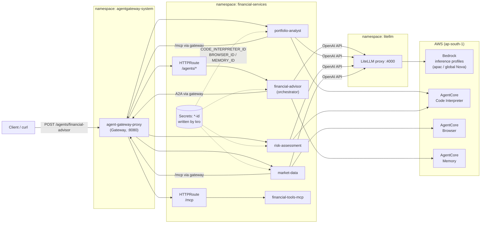
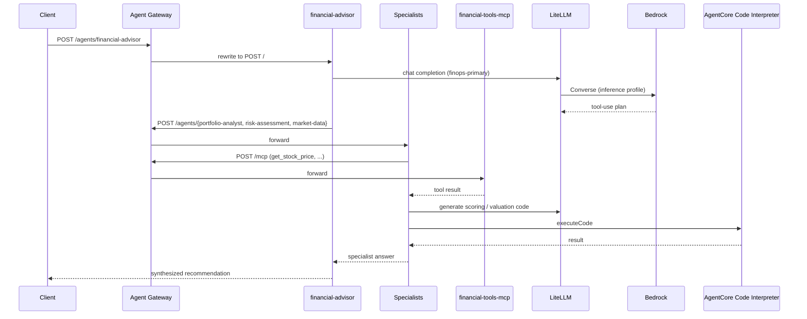

# Financial Services Agents - End-to-End Test Log

Date: 2026-10-11
Cluster: `finops-agents-app-*` (EKS, `ap-south-1`; CI recreates the cluster with a new suffix each run)

## Test request

```bash
kubectl port-forward -n agentgateway-system svc/agent-gateway-proxy 8080:8080 &
TOKEN=$(kubectl create token financial-advisor-sa -n financial-services --duration=1h --audience=agent-gateway)
curl -sS -X POST http://localhost:8080/agents/financial-advisor \
  -H "Authorization: Bearer $TOKEN" \
  -H "Content-Type: application/json" \
  -d '{"task":"I have 100 AAPL and 50 GOOGL. Is my portfolio balanced for medium risk?"}'
```

## Architecture



## Request sequence



## Findings and fixes

| # | Symptom | Root cause | Fix | File |
|---|---------|-----------|-----|------|
| 1 | `404 route not found` from gateway | No `HTTPRoute` existed for any agent | One route per agent, `/agents/<name>` rewritten to `/` | `apps/financial_services/financial-services-stack/templates/21-agent-routes.yaml` |
| 2 | Agent returned `{"error":"Connection error."}` | `litellm` ArgoCD app failed with `DeadlineExceeded` cloning the BerriAI git repo, so LiteLLM never deployed | Use OCI chart `ghcr.io/berriai/litellm-helm` `1.83.10-stable` | `gitops/root/templates/30-litellm.yaml` |
| 3 | Bedrock 400: on-demand throughput not supported for `amazon.nova-micro-v1:0` | Nova models in `ap-south-1` need inference profiles | Use `apac.amazon.nova-*` / `global.amazon.nova-2-lite-v1:0`; fix fallback groups | `gitops/addons/litellm/values.yaml` |
| 4 | Specialist tools failed with `404 Not Found` | No gateway route for `/mcp` | Added `/mcp` `HTTPRoute` to `financial-tools-mcp:8000` (no path rewrite) | `21-agent-routes.yaml` |
| 5 | `CODE_INTERPRETER_ID not set`, "technical issues" in answers | Chart never injected AgentCore IDs; agent roles had no AgentCore permissions | Inject `MEMORY_ID` / `BROWSER_ID` / `CODE_INTERPRETER_ID` from kro Secrets; add `bedrock-agentcore:*` to agent roles | `20-agent-deployments.yaml`, `01-iam-roles.yaml` |
| 6 | Advisor asks for risk tolerance instead of delegating | Two causes: (a) `finops-primary` (Nova Micro) too weak for the tool-use workflow; (b) each agent server keeps one long-lived `Agent`, so conversation history from earlier requests leaks into later ones (specialist logs show "reuse the previous results") | (a) Switch `finops-primary` to `apac.amazon.nova-pro-v1:0`; (b) restart pods for a clean history now, and in code build a fresh agent per request plus a prompt line to use the stated tolerance (needs image rebuild) | `gitops/addons/litellm/values.yaml`, `agents/*/server.py`, `agents/financial-advisor/agent.py` |
| 7 | Agent-to-agent calls were unauthenticated: no `Authorization` header sent, and the gateway accepted anything; specialists were also reachable directly via their Service | The documented JWT/authz policies (`gateway-policies.yaml`) were never written, the agent pods had no projected token (`/var/run/secrets/agent-gateway/token`), and no NetworkPolicy existed | Gateway-level JWT authn (EKS OIDC issuer, audience `agent-gateway`), per-route CEL authz (only the advisor SA may call specialists; only specialist SAs may call `/mcp`), projected SA token in every agent pod, NetworkPolicy allowing ingress only from the gateway proxy, and the EKS Auto Mode network policy controller ConfigMap | `22-gateway-policies.yaml`, `23-network-policy.yaml`, `20-agent-deployments.yaml`, `gitops/addons/auto-mode-defaults/network-policy.yaml` |

## Recorded outputs

### Before any fix (gateway)

```text
route not found
HTTP 404
```

### After route fix, LiteLLM missing (direct and via gateway)

```json
{"error":"Connection error."}
```

### After LiteLLM deployed, wrong model IDs

```text
BedrockException - Invocation of model ID amazon.nova-micro-v1:0 with on-demand
throughput isn't supported. Retry your request with the ID or ARN of an
inference profile that contains this model.
```

### After model IDs fixed, no `/mcp` route

Advisor delegated to all three specialists, but market-data reported:

```text
Both the live quote and market trend tools are currently failing with a "404 Not Found" error.
```

### MCP route verified through the gateway

```json
{"jsonrpc":"2.0","id":1,"result":{"content":[{"type":"text","text":"{'success': True, 'symbol': 'AAPL', 'price': 175.5, 'currency': 'USD', 'timestamp': '2026-10-11T07:17:56.699326'}"}]}}
```

### Specialists after AgentCore IDs and IAM fix (called directly via gateway)

`risk-assessment` (Code Interpreter executed):

```text
Numeric Risk Score: 32
Within Tolerance: Yes
Recommendation: Risk is within acceptable levels.
```

`portfolio-analyst` (Code Interpreter executed; used placeholder prices because
MCP calls returned 503 while the gateway proxy and MCP pods were restarting):

```text
Total Value: $155,000.00 (placeholder prices)
AAPL: 9.68%   GOOGL: 90.32%
```

`market-data`: returned a 503-based "unable to fetch price" message during the same
restart window. In-pod and gateway `/mcp` calls succeeded immediately afterwards.

### Advisor (final run with Nova Micro)

HTTP 200, but the model asked for the client's risk tolerance instead of delegating:

```text
User, to evaluate if your portfolio is balanced for medium risk, I need to know
your current risk tolerance. Are you currently leaning towards conservative,
medium, or aggressive risk?
```

## Re-test after all fixes (Nova Pro, agent pods restarted)

Checks before the call:

- LiteLLM ConfigMap has `finops-primary -> bedrock/apac.amazon.nova-pro-v1:0`; both new LiteLLM pods `Running`.
- All four agent deployments have `CODE_INTERPRETER_ID` / `BROWSER_ID` / `MEMORY_ID` set.
- `HTTPRoute`s present for the four agents and `financial-tools-mcp`.
- `POST /mcp` `get_stock_price` through the gateway returned HTTP 200 with a price for AAPL.

Intermediate runs (agents carrying history from earlier requests): the advisor still asked for the
client's risk tolerance and did not delegate, first on Nova Micro, then on Nova Pro.

Final run (Nova Pro, agent pods restarted so history was empty):

```json
{"result":"The total value of your portfolio is $24,562.50, with AAPL making up 71.45% and GOOGL making up 28.55% of the portfolio. The risk score for your portfolio is 32.5, which is within your medium risk tolerance. The risk assessment specialist recommends holding the current positions, as the risk is manageable and within your tolerance. However, it is always advisable to regularly review the portfolio to ensure it remains aligned with your risk tolerance and investment goals."}
```

Check: 100 x 175.5 + 50 x 140.25 = 24,562.50; weights 71.45% / 28.55%. The risk score of 32.5
comes from the risk-assessment agent's Code Interpreter run (0.5 x 0.30 + 0.5 x 0.35 = 0.325).
Specialist logs show the generated Python being executed in AgentCore Code Interpreter.

## Authentication and network isolation test

Baseline before the fix (live cluster):

```text
no auth -> /mcp                      -> HTTP 200
direct market-data healthz (pod IP)  -> 200
```

After applying the policies, run from inside the cluster with tokens from
`kubectl create token <sa> --audience=agent-gateway`:

```text
no auth header           -> HTTP 401
bad bearer               -> HTTP 401
wrong audience           -> HTTP 401
market -> risk (A2A)     -> HTTP 403
advisor -> /mcp          -> HTTP 403
market -> /mcp           -> HTTP 200
advisor -> market (A2A)  -> HTTP 200
```

Direct calls to the specialists and the MCP server from the advisor pod:

```text
# NetworkPolicy created, controller not enabled
direct market-data / risk-assessment / portfolio-analyst  -> 200 (policy not enforced)

# after enabling enable-network-policy-controller
direct market-data / risk-assessment / portfolio-analyst / financial-tools-mcp -> BLOCKED (ConnectTimeout)
```

Full advisor request with Strict authn, authz, in-pod projected tokens and the NetworkPolicy active:
HTTP 200, total value $24,562.50 (AAPL 71.45% / GOOGL 28.55%), risk score 31.65 within medium tolerance,
recommendation to rebalance. The specialists reached `/mcp` with their own tokens.

## Status

| Component | Status |
|-----------|--------|
| EKS cluster, ArgoCD apps | Working |
| Agent Gateway routes (`/agents/*`, `/mcp`) | Working |
| LiteLLM to Bedrock (inference profiles) | Working |
| AgentCore Code Interpreter (risk, portfolio) | Working |
| MCP tools via gateway | Working |
| Gateway JWT authn + per-route authz | Working (401 / 403 / 200 matrix verified) |
| Direct pod access bypassing the gateway | Blocked by NetworkPolicy once the Auto Mode controller is enabled |
| Advisor orchestration | Working after Nova Pro and a clean agent history; durable fix (fresh agent per request) is in the repo but needs an image rebuild |

## Open items

- Rebuild and push the agent images so the per-request agent change in `agents/*/server.py` and the
  advisor prompt update take effect. Until then, restart the agent pods to clear conversation history.
- `agents/portfolio-analyst/server.py` is missing from the repo although its Dockerfile copies it;
  add it before rebuilding that image.
- `/agents/financial-advisor` has authn only: any valid cluster token with the `agent-gateway` audience can call it.
  Add an authz rule or a separate external IdP if it must be restricted further.
- Two cluster-wide edits are needed for network isolation: the `amazon-vpc-cni` ConfigMap (in
  `gitops/addons/auto-mode-defaults`) and the policy itself. NetworkPolicy does nothing on Auto Mode without the ConfigMap.
- `bedrock-agentcore:*` on `Resource: "*"` is broad; scope it for production.
- A real service-account token was pasted into an editor tab earlier; do not commit it.
